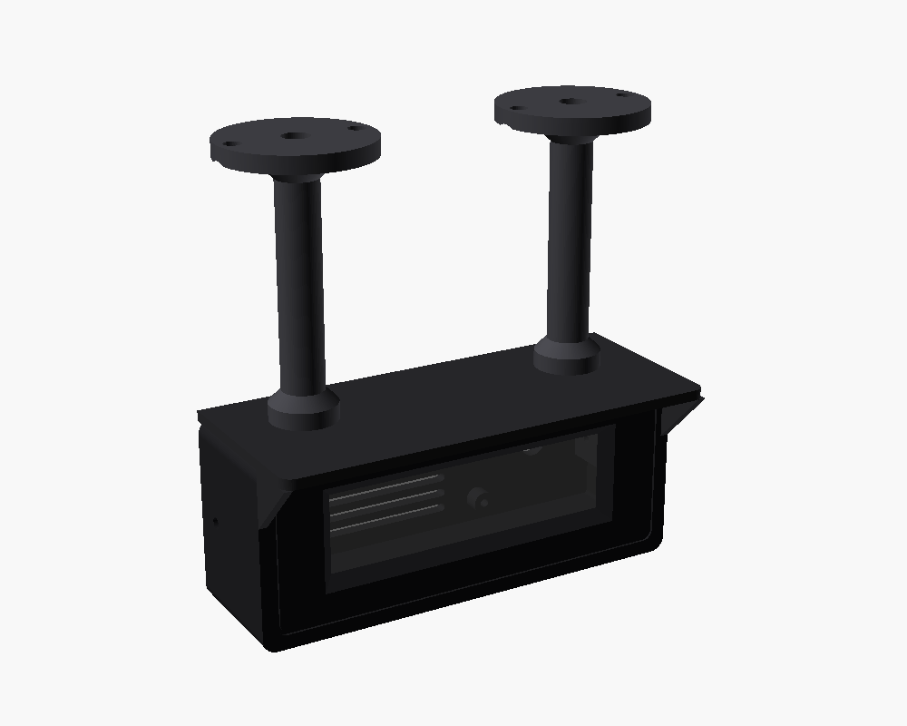
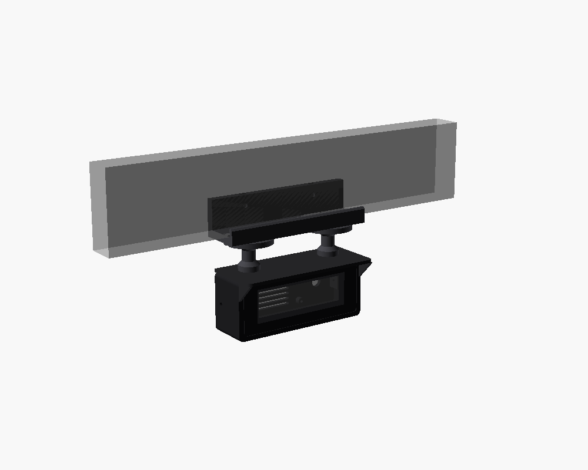
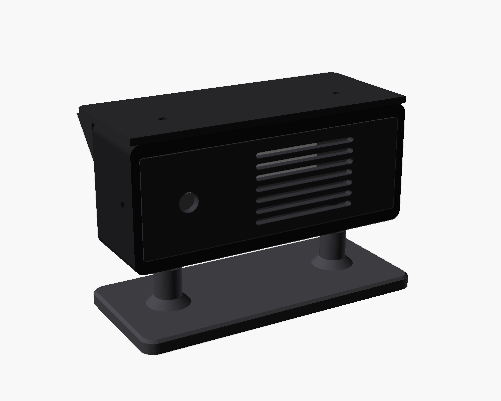

# 3D Printed Case

## v2 (`train_display_case_v2.scad`)

A station-style housing with a recessed, chamfered window, a sun hood and a barrel jack on the back. It mounts three ways: hanging from the ceiling, clamped under a monitor, or on a desk stand.

| Hanging | Under a monitor | Desk stand (rear) |
|---|---|---|
|  |  |  |

### Before printing: measure your OLED

3.12" SSD1322 modules vary between sellers. The defaults at the top of the `.scad` file match the v1 case. Check them against your board and change them if they differ:

- `pcb_w`, `pcb_h`: the board outline
- `oled_hole_dx`, `oled_hole_dz`: the spacing between the mounting holes
- `win_w`, `win_h`, `win_z`: the visible screen area
- `jack_d`: the hole for your barrel jack's thread

For the monitor clamp, measure the bottom of your monitor too (the defaults are guesses for a BenQ PD2500Q):

- `mon_edge_t`: how thick the monitor is front to back, about 10 mm up from its bottom edge
- `mon_front_lip`: height of the lip over the front bezel. Keep it below the bottom bezel so it doesn't cover the picture.
- `mon_rod_len`: rod length. With the default 20 mm, the display hangs about 80 mm below the monitor's bottom edge, so check the monitor is set high enough on its stand.

To regenerate the STLs:

```sh
for p in body back hood hanger stand hanger_monitor monitor_clamp; do
  openscad -D "part=\"$p\"" -o "train_display_case_v2_$p.stl" train_display_case_v2.scad
done
```

### Printing

Print in black PLA or PETG. Every part prints flat in the orientation it is exported in, with no supports.

| Part | Orientation |
|---|---|
| `body` | Face down |
| `back` | Outside face down |
| `hood` | Top face down, side cheeks up |
| `hanger` | Two rods, ceiling disc down |
| `hanger_monitor` | Two short rods, disc down |
| `monitor_clamp` | Base down, lips up |
| `stand` | Base down |

### Hardware

| Qty | Item | Use |
|---|---|---|
| 4 | M2.5 x 6 screws | OLED to the body standoffs |
| 4 | M2.5 x 6 screws | Pi Zero to the back panel standoffs |
| 2 | M2.5 x 8 screws | Through the side walls into the back panel tabs |
| 4 | M3 nuts | Pressed into the hex pockets inside the top and bottom walls |
| 2 | M3 x 12 socket cap bolts | Rods to the body, through the hood (M3 x 10 without the hood) |
| 2 | M3 x 8 bolts | Hood to the body when using the stand |
| 2 | M3 x 10 socket cap bolts | Stand to the body |
| 4 | M3 x 8 countersunk self-tapping screws | Short rod discs to the monitor clamp |
| 2 | M3 x 16 thumbscrews or bolts + 2 M3 nuts | Monitor clamp grip, with a felt or rubber pad on each tip |
| 1 | 5.5 x 2.1 mm threaded panel-mount DC jack | Power |

### Assembly

1. Press the four M3 nuts into the hex pockets inside the top and bottom walls. Add a drop of glue if they are loose.
2. Slide the OLED in from the back, glass forward, and screw it to the four front standoffs.
3. Screw the Pi Zero to the back panel standoffs, components facing into the case. Fit the barrel jack and tighten its nut.
4. Wire the jack to the Pi:
   - centre pin (+5 V) to header pin 2 or 4
   - sleeve (GND) to pin 6

   Use a regulated 5 V supply of 2 A or more. This bypasses the Pi's micro-USB input protection, so check the polarity before powering on.
5. Wire the OLED to the Pi, push the back panel into the opening, and fit the two side screws.
6. Place the sun hood on top of the body, lining up its two holes with the mounting holes.
7. Attach the rods or the stand. Drop each bolt down the hollow rod or post and tighten it with a long 2.5 mm hex key.
   - **Ceiling:** bolt the rods through the hood to the display first, then screw the discs to the ceiling.
   - **Monitor:**
     1. Bolt the short rods through the hood to the display.
     2. Screw the rod discs to the underside of the clamp.
     3. Drop the two nuts into the slots in the clamp's rear lip.
     4. Hook the clamp over the monitor's bottom edge.
     5. Tighten the thumbscrews against the back of the monitor until the clamp is firm. Put pads on the tips so they don't mark the plastic.
   - **Desk stand:** bolt the hood on with M3 x 8 bolts, then bolt the stand to the bottom with M3 x 10.

## v1

`Train Display Case.scad` / `Train Display Case Back.scad` hold the original glued bezel and open-bottomed back.
